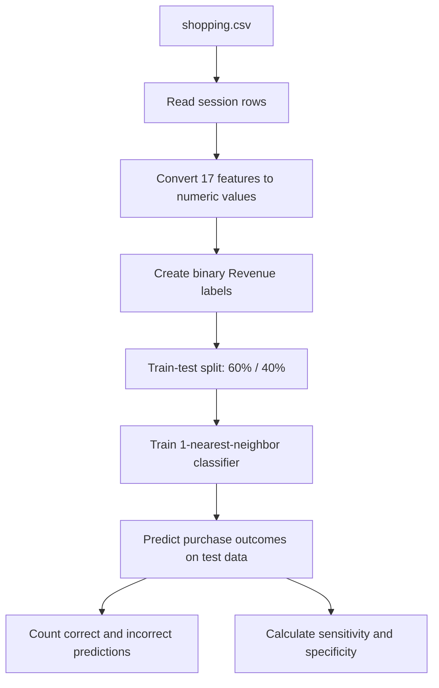

# Shopping — Purchase Intent Prediction with Machine Learning

**Harvard CS50's Introduction to Artificial Intelligence with Python · Project 8/12**

Predict whether an online shopping session will result in a purchase using a **1-nearest-neighbor (1-NN) classifier** trained on session behavior data. The project illustrates the full supervised-learning workflow: data loading, categorical encoding, model fitting, holdout evaluation, and interpretation of class-specific performance.

> **Portfolio note:** This repository documents work completed for Harvard CS50AI. The project is an educational exercise, not a production-ready purchase-intent prediction service. The original assignment is described on the [CS50AI Shopping project page](https://cs50.harvard.edu/ai/projects/4/shopping/).

## Overview

An online store can record how visitors navigate its website: page counts, time spent, bounce and exit rates, traffic sources, and session context. Here, that information is used to predict a binary outcome:

- **`1` — Revenue = TRUE:** the session ended in a purchase.
- **`0` — Revenue = FALSE:** the session did not end in a purchase.

The goal is not simply to maximize overall accuracy: because most sessions do not result in a purchase, **sensitivity** and **specificity** offer a more informative view of model behavior.

## Technical Highlights

| Component | Implementation in this project |
| --- | --- |
| Language | Python |
| Dataset | `shopping.csv` — 12,330 sessions, 17 predictors and one target column |
| Data ingestion | Python `csv.DictReader` |
| Encoding | Month abbreviations mapped to `0–11`; visitor type and weekend represented as binary values |
| Model | `sklearn.neighbors.KNeighborsClassifier(n_neighbors=1)` |
| Data split | 60% training / 40% testing via `train_test_split` |
| Evaluation | Correct/incorrect prediction counts, sensitivity and specificity |
| External library | scikit-learn (and its installed dependencies) |

**Dataset composition:** 1,908 purchase sessions and 10,422 non-purchase sessions. This class imbalance matters when interpreting the results.

## How It Works



### 1. Feature preparation

Each record is transformed into 17 numeric input features in this order:

| # | Feature | Type / transformation |
| --- | --- | --- |
| 1 | `Administrative` | Integer |
| 2 | `Administrative_Duration` | Float |
| 3 | `Informational` | Integer |
| 4 | `Informational_Duration` | Float |
| 5 | `ProductRelated` | Integer |
| 6 | `ProductRelated_Duration` | Float |
| 7 | `BounceRates` | Float |
| 8 | `ExitRates` | Float |
| 9 | `PageValues` | Float |
| 10 | `SpecialDay` | Float |
| 11 | `Month` | Index from January (`0`) to December (`11`) |
| 12 | `OperatingSystems` | Integer category code |
| 13 | `Browser` | Integer category code |
| 14 | `Region` | Integer category code |
| 15 | `TrafficType` | Integer category code |
| 16 | `VisitorType` | `1` for returning visitors; `0` otherwise |
| 17 | `Weekend` | `1` for `TRUE`; `0` for `FALSE` |

The `Revenue` column is the **target label**, not an input feature. The data-loading logic accepts the CSV column names shown above.

### 2. K-nearest neighbors

The trained model uses **k = 1**. For each test session, it identifies the nearest training example according to the classifier's distance metric and assigns that example's purchase/non-purchase label.

The implementation does **not** apply feature scaling, class rebalancing, cross-validation or hyperparameter optimization. These are potential improvements, not features claimed for this submission.

### 3. Model evaluation

With *TP* = true positives, *FN* = false negatives, *TN* = true negatives, and *FP* = false positives:

$$
\text{Sensitivity} = \frac{TP}{TP + FN}
$$

$$
\text{Specificity} = \frac{TN}{TN + FP}
$$

- **Sensitivity (true positive rate):** fraction of purchasing sessions correctly identified.
- **Specificity (true negative rate):** fraction of non-purchasing sessions correctly identified.

These metrics are particularly useful with an imbalanced dataset: a model could achieve high overall accuracy simply by predicting *no purchase* for most sessions.

## Project Structure

```text
shopping/
├── shopping.py      # CSV preprocessing, 1-NN model, evaluation, CLI
├── shopping.csv     # 12,330 online-session records
└── README.md        # Project documentation
```

Your local source archive also contained a `__pycache__/` directory holding generated Python bytecode. This is a temporary execution artifact; it is not required to run the project and can be excluded from version control.

## Requirements

- Python 3.12 is a suitable choice for the CS50AI course environment.
- `scikit-learn` installed in the active Python environment.

Install the dependency:

```powershell
python -m pip install scikit-learn
```

## Run the Project

From the project directory:

```powershell
cd "X:\IO++\GitHub Upload\shopping"
python shopping.py shopping.csv
```

Equivalent cross-platform command when already inside the project directory:

```bash
python shopping.py shopping.csv
```

The program prints the number of correct and incorrect classifications and the true positive and true negative rates.

### Verified example output

A successful run using the supplied data produced:

```text
Correct: 4099
Incorrect: 833
True Positive Rate: 39.62%
True Negative Rate: 91.28%
```

**Important:** `train_test_split` is called **without a fixed random seed**, so training/test membership and evaluation metrics may change on subsequent runs. These values document one observed execution, not a guaranteed benchmark.

## What the Results Mean

The example run achieved substantially higher specificity than sensitivity. That means the classifier was more successful at recognizing **non-purchasing sessions** than at identifying sessions that resulted in a purchase. The dataset contains far more non-purchasing than purchasing sessions, so this asymmetry deserves attention.

Possible next experiments for an independent extension include standardized numeric features, stratified splitting, several values of `k`, alternative classification algorithms, and precision/recall analysis. These are **future directions** rather than implemented project features.

## Skills Demonstrated

- Supervised machine learning and binary classification
- K-nearest neighbors (KNN)
- CSV processing and feature encoding in Python
- Training/test data separation
- Confusion-matrix concepts, sensitivity and specificity
- Interpretation of class imbalance and model limitations
- Working with scikit-learn

## Academic Attribution

Developed as part of **CS50's Introduction to Artificial Intelligence with Python**, Harvard University's CS50 course. Starter materials and assignment requirements are attributable to CS50 and its teaching staff.

- [Original Shopping assignment](https://cs50.harvard.edu/ai/projects/4/shopping/)
- [CS50AI course](https://cs50.harvard.edu/ai/)
- [Verified course completion certificate](https://cs50.harvard.edu/certificates/4d1848b5-b7cc-4b37-8155-819e19e6054d)

**Academic integrity:** CS50's policy restricts sharing assessed solution code. This README is intended as a public explanation of the work; any distribution of solution files or original datasets should comply with the course's policies and applicable usage terms.
